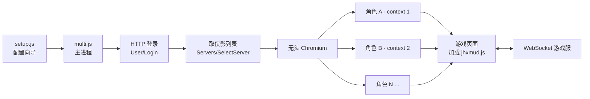

<div align="center">

# 江湖行 · 脱机挂机工具

把网页版 MUD「江湖行」跑在无头浏览器里。挂到一台常开的服务器上，你自己的电脑该关就关。

[](https://nodejs.org)
[](LICENSE)
[]()

</div>

---

## 它解决什么问题

网页 MUD 的"挂机脚本"（游戏设置里那个**脚本地址**）本质是一段跑在页面里的 JS。
浏览器一关，脚本就停了 —— 所以所谓"脱机"，关键不是写脚本，而是**让那个页面一直活着**。

这个工具用无头 Chromium 在后台养着页面，于是：

- ✅ 不开窗口、不占屏幕，本机跑也不影响你干别的
- ✅ 断线自动重连，崩了自动重启
- ✅ 五个角色共用一个浏览器进程，内存只有开五个浏览器的三分之一
- ✅ 游戏自带的挂机逻辑原样生效（战斗、副本、日常都不用重写）

> ⚠️ **"脱机"的前提是挂机进程跑在一台一直开着的机器上**（VPS、旧笔记本、NAS、树莓派）。
> 在**自己电脑**上直接双击运行时：**关掉那个黑窗口 = 停止，关机 = 停止**，
> 没有任何魔法能让进程在断电后继续存在。想真正脱机，看下面的「部署到服务器」。

## 效果

| 指标 | 实测 |
|---|---|
| 单角色内存 | 342 MB |
| 五角色内存 | 840 ~ 909 MB（9 个进程） |
| 从启动到进游戏 | ~10 秒 |
| 五个角色全部上线 | ~10 秒（并发） |

## 架构



每个角色一个独立 `context`：cookie 和 localStorage 互不干扰，所以**多账号也能同时挂**；
但它们共享同一个浏览器内核，省掉重复的字体缓存、GPU 进程等开销。

## 两套方案

|  | `jhmud-afk` 浏览器版 | `jhmud-bot` 协议版 |
|---|---|---|
| 原理 | 无头 Chromium 跑真实页面 | 纯 WebSocket，不用浏览器 |
| 内存 | 每角色 ~170 MB | 每进程 ~60 MB |
| 功能 | **完整**，靠游戏自带脚本 | 骨架：登录 + 收帧 + 发指令 |
| 适合 | 日常挂机（推荐） | 定时跑固定流程 |
| 状态 | ✅ 可用 | 🚧 逻辑待写 |

## 快速开始

### 本机试玩（Windows）

```text
1. 双击  jhmud-afk/安装依赖.bat      首次：下载浏览器内核（约 150MB）
2. 双击  jhmud-afk/配置账号.bat      回答：账号 → 密码 → 要挂哪些角色
3. 双击  jhmud-afk/启动挂机.bat      开始挂机
```

⚠️ 在这台电脑上运行时，**关掉那个黑窗口就停了**，关机更是直接断。
这个模式只适合人在电脑前、临时挂着。要真脱机，看下面一节。

配置向导长这样：

```
账号：你的账号
（密码会显示在屏幕上，输了什么就是什么）
密码：你的密码
查到 5 个侠影：
  1. 侠客甲   2. 侠客乙   3. 侠客丙   4. 侠客丁   5. 侠客戊

要挂哪些？直接回车=全部，或输入序号（如 1,3,5 或 2-4）：
>
```

### 部署到服务器（真正的脱机）

找个**一直开机**的地方跑：VPS、旧笔记本、NAS、树莓派都行。进程在那儿，你的电脑关不关都无所谓。

```bash
cd jhmud-afk
chmod +x *.sh

./install.sh          # 装 Node、依赖、Chromium；内存 < 3G 自动加 swap
node setup.js         # 问答式配置
./start.sh            # 前台运行

sudo ./install-service.sh   # 可选：开机自启 + 崩溃自动重启
journalctl -u jhmud -f      # 看日志
```

只有做完这一步，才谈得上"关掉自己电脑角色还在线"。

## 配置

生成的 `config-multi.json`（已在 `.gitignore` 里，不会被提交）：

```json
{
  "url": "http://175.178.190.184/",
  "accounts": [
    { "user": "你的账号", "pass": "你的密码", "roles": ["侠客甲", "侠客乙"] },
    { "user": "另一个账号", "pass": "另一个密码", "roles": [] }
  ],
  "headless": true,
  "checkEvery": 20,
  "blockCss": true
}
```

| 字段 | 说明 |
|---|---|
| `roles` | 填名字只挂指定的；留 `[]` 自动挂该账号下全部侠影 |
| `checkEvery` | 多少秒探一次连接，断了自动重建 |
| `blockCss` | 拦掉 CSS 省内存（页面没样式但功能正常）；脚本异常就设 `false` |

## 实现要点

- **登录链路**：`User/Login` → `Servers/GetServer` → `Servers/SelectServer`（带 cookie）→
  `Role/SelectRole`（拿到 key）→ `ws://<Ip>:<Port>` → 收到「登录信息确认：」后发 `login <key>\n`
- **帧格式**：`^^` 分隔；`{type:"..."}` 是控制帧，**key 无引号、允许尾逗号**，用 `json5` 解析
- **编码**：下行是 GB2312 二进制帧，上行指令必须带 `\n`
- **角色校验**：登进去后比对 `User.role.Name`，进错角色会报错重登

## 常见问题

**双击 bat 报「'cho' 不是内部或外部命令」**
批处理文件的换行被写成了 LF。仓库里的 `.gitattributes` 已强制 `.bat` 用 CRLF，
重新克隆即可；实在不行直接命令行 `node multi.js`。

**密码输不进去 / 提示密码错误**
向导是明文显示的，看到什么就是什么。输错会让你原地重试，不用从头来。

**角色名写错会怎样**
脚本会一直重试并打印「角色列表里没找到」。改 `config-multi.json` 或重跑 `配置账号.bat`。

**内存吃紧怎么办**
每个角色约 170 MB。2G 的机器建议不超过 6 个角色，并跑 `./install.sh` 自动加 2G swap。
再紧就上 `jhmud-bot` 协议版（每进程 60 MB）。

**账号在别处登录会冲突吗**
会。同一账号两处同时登录会互相踢下线，换机器前先关掉旧的。

**游戏改版后进不去了**
页面元素变了。跑 `node probe.js` 打印当前按钮文案和全局对象，按输出改 `multi.js` 里的点击文案。

## 目录

```
jhmud-afk/
  multi.js            多账号/多角色挂机主程序
  afk.js              单角色版本
  setup.js            问答式配置向导
  install.sh          Linux 一键安装
  start.sh            Linux 启动
  install-service.sh  Linux systemd 服务
  *.bat               Windows 双击脚本
  probe.js            页面结构探针
  record.js           HTTP / WebSocket 抓包工具

jhmud-bot/
  src/socket.js       WebSocket + 按 type 派发事件
  src/cmd.js          指令队列（500ms 限速）
  src/login.js        HTTP 登录换 key
  src/events/         场景事件，文件名即帧的 type
```

## 免责声明

仅供学习与个人使用。工具不修改游戏、不绕过任何机制，只负责"把页面养活着"。
请遵守所在服务器的规则，使用产生的后果由使用者自行承担。

仓库不包含游戏客户端代码，也不包含任何账号信息。

## License

[MIT](LICENSE)
